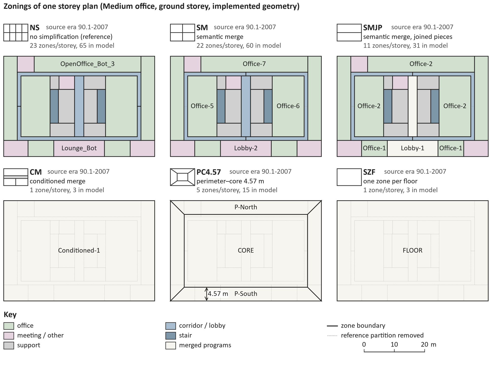
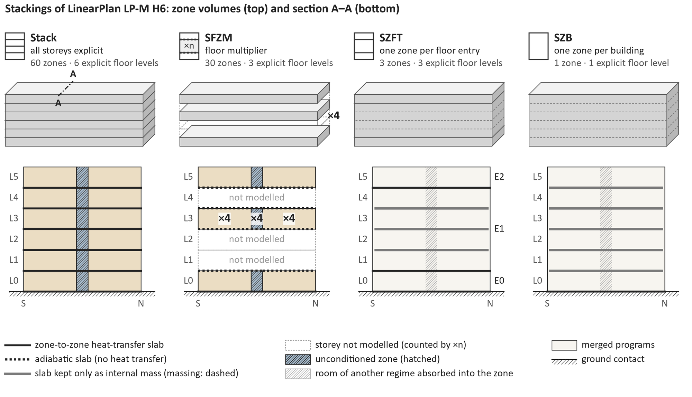

# Methods

## Question

Urban-scale building energy models simplify buildings. Rooms are merged into a few thermal zones, and storeys are represented by a multiplier or merged into a single zone. This study asks how much of that detail matters. Each simplified model is compared with a detailed EnergyPlus reference of the same building, in which every room is a zone and every storey is explicit.

## Design

| Factor | Levels |
|---|---|
| Building types | 10 midrise apartment plan families (LinearPlan, PointPlate, CourtCluster, StairPair, RadialLobes, WingedBand, OpenCourt, EnclosedCourt, GalleryBar, StairBayBar), a highrise apartment, a terrace row, and the DOE small, medium and large offices |
| Climates | 19 weather files, ASHRAE 169 zones 0A to 8 |
| Code eras | ASHRAE 90.1-2019 and 90.1-2007, DOE Reference 1980–2004 and pre-1980, as available per building type |
| Main block | 1,046 contexts at each type's canonical size and height |
| Panel | 224 contexts with size and height variants, in climates 4A and 7 |
| Models | 79 combinations of zoning, stacking and program assignment per context |

Programs, schedules, constructions and internal loads come from the same sources for every model of a context. Only geometry and zoning change, and each model keeps the programs of the rooms it merges (assignment `/o`). Two further assignments, `/f` and `/u`, are in the [data](data.md#methods), but not on the poster.

## Zonings and stackings

<figure markdown>
{ loading=lazy }
<figcaption>Zonings of one storey of the medium office. NS: every room a zone (reference); SM: semantic merge; SMJP: semantic merge with joined pieces; CM: conditioned merge; PC4.57: perimeter–core, 4.57 m; SZF: one zone per floor.</figcaption>
</figure>

<figure markdown>
{ loading=lazy }
<figcaption>Stackings (LinearPlan, 6 storeys). The floor multiplier (SFZM) also makes interstorey surfaces adiabatic; one zone per floor entry (SZFT) and one zone per building (SZB) turn merged slabs into internal mass.</figcaption>
</figure>

## Error measures

Each error compares the model's hourly ideal sensible load with the reference's, for heating and for cooling separately. Both are divided by the reference's conditioned floor area, so every error is per m² of the same building:

- **Hourly RMSE** (W/m²): the root mean square of the hourly differences. It captures errors in when a load occurs as well as how much.
- **Signed annual error** (kWh/m²a): the difference in annual demand. Errors at different hours can cancel in it.
- **Coarser resolutions:** the explorer also shows the RMSE of daily and monthly means, and it can compute any resolution for one context. RMSE shrinks as the resolution coarsens, because timing errors average out. That shrinking is the poster's title: detail that matters hour by hour is lost in aggregation.

Every definition is in the [data dictionary](data.md#case-table-columns).

## Climate classes

The poster groups climates into four classes of ASHRAE 169 thermal zones. ASHRAE defines those zones by heating degree days at base 18 °C (HDD18) and cooling degree days at base 10 °C (CDD10). The HDD18 ranges of the 19 weather files do not overlap between classes:

| Class | Zones | HDD18 | Main-block contexts |
|---|---|---|---|
| Hot | 0–2 | 0–885 | 292 |
| Mixed | 3–4 | 1,310–2,627 | 348 |
| Cool | 5–6 | 3,201–4,518 | 290 |
| Cold | 7–8 | 5,507–7,121 | 116 |

## Cost

CPU time was measured as process CPU time with 64 concurrent workers, not as wall time. The poster reports each model's ratio to its reference over matched timed contexts. Ratios that differ by less than about 1.5× are within the timing noise.

## Limits

- **Simulation only.** These are comparisons between simulations of the same building, not validation against measurements.
- **Ideal loads.** Loads are ideal sensible loads. HVAC systems and their part-load behaviour are not modelled.
- **Source quirks.** The small office's occupied-zone infiltration is about 2.6–2.7× the source, because the attic is omitted. The medium and large offices include source-defined concrete drop-ceiling mass.
- **Shared runs.** Several method labels can share one simulation when their models are identical (deduplicated after export), so cases are not independent samples. `result_source` and `duplicate_of` in the case table record this.
